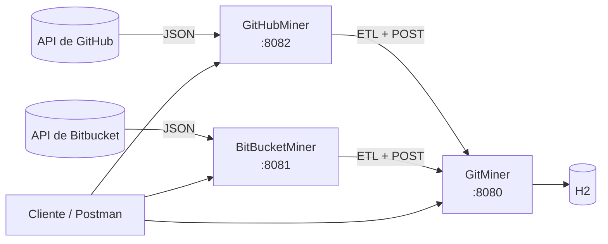

# Git Miners

Dos microservicios REST en **Spring Boot** (GitHubMiner y BitBucketMiner) que extraen **commits, issues y comentarios** de repositorios de **GitHub** y **Bitbucket**, los transforman a un modelo común y los envían a **GitMiner**, un servicio central que los almacena y los expone por API.

Proyecto individual de la asignatura **Acceso e Integración de Sistemas de Software (AISS)**, Grado en Ingeniería del Software, Universidad de Sevilla (2025).


## ¿Qué problema resuelve?

Cada plataforma (GitHub, Bitbucket) devuelve los datos con una estructura distinta. Estos servicios los **normalizan** a un único modelo (`Project`, `Commit`, `Issue`, `Comment`, `User`), de forma que GitMiner pueda guardar y consultar datos de ambas plataformas sin importar su origen.

## Arquitectura



Cada miner sigue la misma estructura en capas:

| Capa | Responsabilidad |
|---|---|
| `controller` | Endpoints REST (previsualizar y enviar datos) |
| `service` | Llamadas a la API externa y envío a GitMiner |
| `etl` | `Transformer`: convierte el modelo de la plataforma al modelo de GitMiner |
| `model` | Clases de la plataforma origen (`github` / `bitbucket`) y del modelo común (`gitminer`) |
| `exception` | Gestión de errores |

## Componentes

| Servicio | Puerto | Java | Spring Boot |
|---|---|---|---|
| **GitMiner** (servicio central, plantilla de la asignatura, **no incluido** en este repositorio) | 8080 | 17 | 2.7.4 |
| **GitHubMiner** (desarrollado por mí) | 8082 | 21 | 3.4.5 |
| **BitBucketMiner** (desarrollado por mí) | 8081 | 21 | 3.4.5 |

## Requisitos

- Java 21
- Maven (o el wrapper `./mvnw` incluido)
- Para enviar datos: una instancia de GitMiner en ejecución (Java 17)

## Cómo ejecutarlo

Estructura del repositorio:

```
.
├── github-miner/      # GitHubMiner (puerto 8082)
├── bitbucket-miner/   # BitBucketMiner (puerto 8081)
└── README.md
```

GitMiner es la plantilla que proporciona la asignatura y no se redistribuye aquí. Para enviar datos hay que tenerlo en marcha en `localhost:8080` (Java 17). Sin GitMiner, los endpoints `GET` de previsualización funcionan igualmente.

```bash
# GitHubMiner (puerto 8082)
cd github-miner
./mvnw spring-boot:run

# BitBucketMiner (puerto 8081), en otra terminal
cd bitbucket-miner
./mvnw spring-boot:run
```

La URL de GitMiner se configura en `src/main/resources/application.properties` de cada miner:

```properties
gitminer.url=http://localhost:8080/gitminer
```

## API de los miners

Los parámetros `nCommits`, `nIssues` y `maxPages` son opcionales (por defecto 5, 5 y 2).

**GitHubMiner**: base `http://localhost:8082/github/{owner}/{repo}`

| Método | Ruta | Descripción |
|---|---|---|
| `GET` | `/github/{owner}/{repo}` | Previsualiza el proyecto completo (sin enviarlo) |
| `POST` | `/github/{owner}/{repo}` | Extrae y envía el proyecto completo a GitMiner |
| `GET` / `POST` | `/github/{owner}/{repo}/commits` | Previsualiza / envía solo los commits |
| `GET` / `POST` | `/github/{owner}/{repo}/issues` | Previsualiza / envía solo los issues (con comentarios) |

**BitBucketMiner**: base `http://localhost:8081/bitbucket/{workspace}/{repoSlug}`, con las mismas rutas y parámetros.

### Ejemplo

```bash
# Previsualizar 3 commits y 3 issues de un repositorio público de GitHub
curl "http://localhost:8082/github/octocat/Hello-World?nCommits=3&nIssues=3&maxPages=1"

# Enviar el proyecto a GitMiner
curl -X POST "http://localhost:8082/github/octocat/Hello-World?nCommits=3&nIssues=3&maxPages=1"

# Comprobar que GitMiner lo ha guardado
curl http://localhost:8080/gitminer/projects
```

## GitMiner (servicio central)

Plantilla de la asignatura, no incluida en este repositorio. Expone una API REST con CRUD sobre proyectos, commits, issues y comentarios (`/gitminer/projects`, `/gitminer/commits`, `/gitminer/issues`, `/gitminer/comments`).

- Documentación Swagger: `http://localhost:8080/swagger-ui/index.html`
- Consola H2: `http://localhost:8080/h2-ui` (la base de datos es en memoria: los datos se pierden al reiniciar)

## Tecnologías

Java 21 · Spring Boot · Spring Web (API REST) · Maven · JSON · API de GitHub · API de Bitbucket 2.0 · H2 (GitMiner)

## Qué aprendí

- Consumir APIs REST de terceros y adaptar sus respuestas, que difieren entre plataformas.
- Diseñar una capa ETL que desacopla el modelo de origen del modelo de destino.
- Estructurar un sistema de varios servicios que se comunican por HTTP.
- Gestionar parámetros de paginación y límites al extraer datos de APIs externas.

## Limitaciones y mejoras futuras

- Los tests están como esqueleto; falta cubrir los servicios y el `Transformer` con pruebas unitarias.
- Las llamadas a GitHub se hacen sin autenticar, por lo que aplica el límite de la API pública. Añadir un token por variable de entorno lo ampliaría.
- Dockerizar los tres servicios con `docker-compose` para arrancarlos con un solo comando.
- Persistir GitMiner en una base de datos externa en lugar de H2 en memoria.

## Créditos

- **GitMiner** es la plantilla proporcionada por la asignatura AISS (Universidad de Sevilla) y no forma parte de este repositorio.
- **GitHubMiner** y **BitBucketMiner**: desarrollo individual de [Francisco Casasola Calzadilla](https://github.com/Pacocc9).
